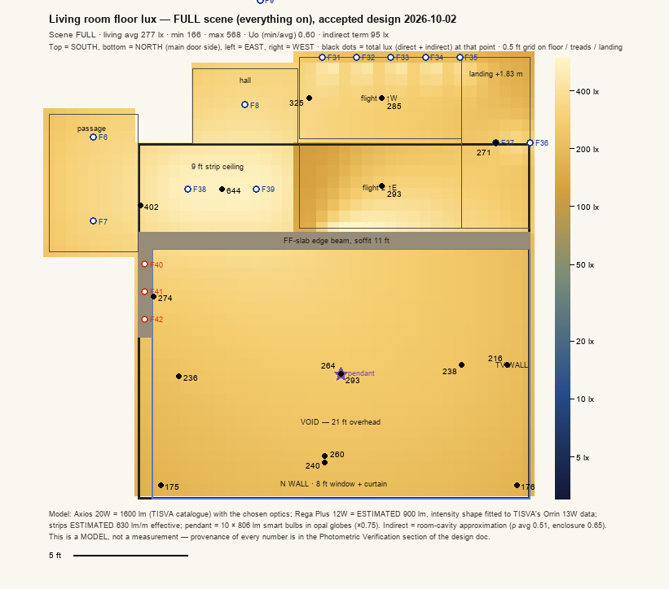
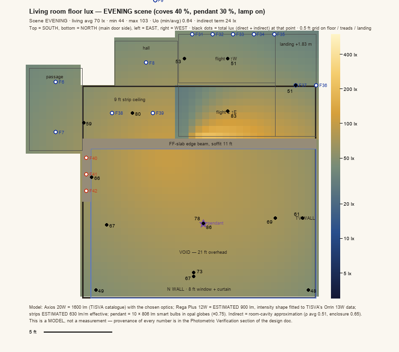
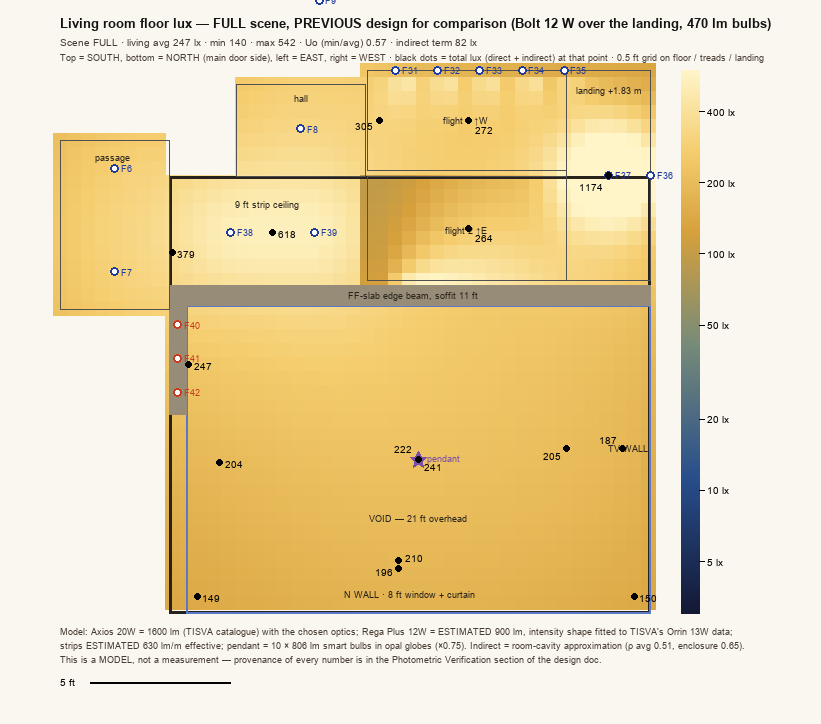
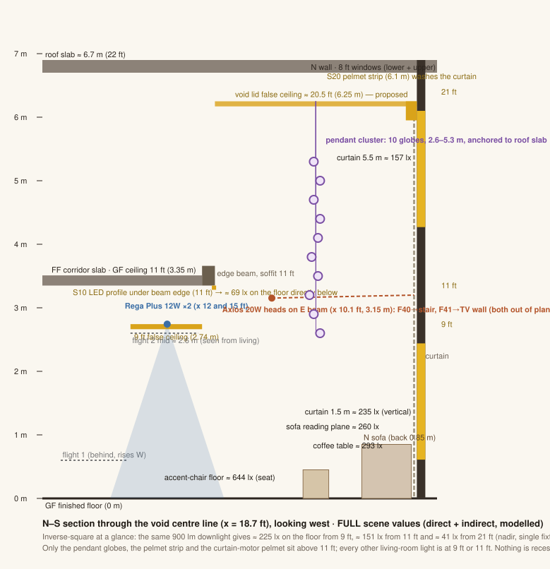

# Lighting + False-Ceiling Design — whole house (TISVA catalogue)

**Status: PROPOSED 2026-09-29 — not yet decision-logged as a whole.** Photometric check of the living room added 2026-10-02 (§ 10); its two changes (half-landing fixture → Avia 7 W aimed at the stair wall; 806 lm pendant bulbs) and the Axios optics are **accepted and decision-logged**. Products are chosen from the TISVA *ARCHITECTURAL Product list – May 25* (Usha International, April-2025 MRP list). Codes and prices are copied from that PDF; **verify every code with the dealer before ordering** (the list says prices change without notice).

**Interactive ceiling map (tap any light for its code, position and switch gang):** https://claude.ai/artifact/E8pURfRVXApDEXaeP6uM3E (private link; share from its Share menu) · offline copy [`lighting-plan/lighting-plan.html`](lighting-plan/lighting-plan.html) — single offline file, works on a phone. Source data = [`lighting-plan/lighting-data.js`](lighting-plan/lighting-data.js) (edit that, then `python3 lighting-plan/build.py`).

Read with: [master-interior-spec.md § C (ceilings) + § L (lighting)](master-interior-spec.md) · [../electrical/conduits-and-cavities.md § PART 3](../electrical/conduits-and-cavities.md) · [../materials-finishes/master-color-palette.md § 4 (colour temperature)](../materials-finishes/master-color-palette.md).

---

## 0. The design in one paragraph

Every room gets **layers, not one bulb**: quiet recessed downlights for general light, aimable spots for the things worth looking at (foyer stone, staircase, TV wall, travertine, idols), task light where hands work (counter, mirrors, desks, bedside), decorative pendants for the two "wow" spots (living void, dining table), and hidden LED strips for the evening glow (coves, beam edges, headboards, shelves). Everything you sit in is **3000K warm white**; only the kitchen is 4000K. The ceiling stays calm: white-trim/black-reflector downlights that disappear into the soft-snow ceiling, black surface cylinders only where there is bare slab, one linear bar in the kitchen. Dimming comes from small Zigbee strip dimmers on every cove and smart bulbs in the pendants, so the already-locked Sonoff on/off wall relays stay exactly as wired.

---

## 1. Lighting, explained plainly (read this first)

**Lumens are brightness, watts are only electricity.** A 12 W LED downlight gives about 1,100 lumens; a 7 W about 650. What you feel is *lux* (lumens landing on a surface). Rough targets: living 100–150 lux, dining table 200–300, kitchen counter 300–500, study desk 300+, bedroom 80–150 (dimmable), bathroom 150–200 with 300 at the mirror, stairs 100–150 on the treads, passages 50–100.

**Colour temperature (K) sets the mood.** 2700–3000K = warm, like a lamp in the evening. 4000K = neutral, honest daylight-ish for cooking. 6500K = cool blue-white, for shops and offices, never for a home. The TISVA catalogue is almost entirely 3K/4K (only one 2700K item exists), so the house standard becomes **3000K** where the spec said 2700K. The one rule that matters more than the exact number: **never mix temperatures in one line of sight** (foyer, passage, living and dining all see each other, so they are all 3000K; the kitchen is 4000K because it is its own work zone).

**CRI is colour honesty.** Colour Rendering Index 90+ shows wood, stone, food and skin as they are; 80 makes everything slightly grey. The catalogue states CRI>90 for Rega Plus and Avia, which is why they carry most of this design.

**Beam angle is the size of the pool.** 15° is a torch (idols, basin), 24–38° is a normal downlight, 110–120° is a soft wash (foot-lights, panels). Linear "grazers" hug a textured wall so every groove throws a shadow.

**Glare is the enemy of luxury.** Deep-recessed downlights with a black reflector hide the bright LED chip until you are right under it. Keep downlights off the pillow line and out of the TV viewer's eye line, spaced roughly 1.2–1.8 m apart and 500–600 mm from walls.

**Layers.** Ambient (general) · Task (hands) · Accent (things to look at) · Decorative (the fixture itself is the ornament) · Glow (hidden strips). Each layer on its own switch or scene: that is what lets one room be a bright cleaning room at 10 am and a soft lounge at 10 pm.

**False ceilings are the lighting's furniture.** A gypsum ceiling 1–2 ft below the slab is where recessed lights, cove strips, drivers, AC pipes, the Wi-Fi AP and sensors hide. Types used here: *full drop* (whole room), *perimeter band* (a 2–3 ft ring, centre stays high for the fan), *coffer* (a small framed square, pooja), *lid* (a ceiling across the top of the double-height void). A *cove* is a pocket along the ceiling edge with a strip inside throwing light up the wall.

**IP ratings.** IP65 = safe under water jets (shower zone). IP44 = splash-safe (dry zone of a bathroom). Anything without a rating goes only under a roof and away from water.

**Dimming, the practical way for this house.** The wall relays are on/off (Sonoff ZBMINI R2, locked). So: (a) every strip gets a matchbox-size **Zigbee 24V strip dimmer** between its driver and the strip, dimmed from Home Assistant, the wall panel or the app; (b) the two pendants take **Zigbee smart bulbs**, fed from the always-on fan gang so the app can dim them; (c) downlights are on/off in groups. That gives 90% of the luxury without changing one switch box.

**Reading a TISVA code.** `806DLR12338912` = Rega Plus · 12 W · **3K** (3000K) · **RR** (round recessed) · **BWHT** (white body) · **RBLK** (black reflector). Also: SR = surface round, RS/SS = square, 4K/65K = 4000K/6500K, DM/DIM = dimmable, ND = not dimmable, TUN = tunable white, TRMLS = trimless, IP65 = water-jet safe, 36D/38D = beam angle.

---

## 2. Whole-house rules (what every room follows)

| Rule | Value |
|---|---|
| Colour temperature | **3000K** in foyer, passage, living, dining, pooja, all bedrooms, bathrooms, stairs, balconies. **4000K** kitchen (bar + under-cabinet), utility, store. Amber 2200K only for the foyer screen halo + pooja niche (generic strips, as already locked). |
| Ambient downlight | **Rega Plus** 7 W (`806DLR733892`) for small rooms/passages, 12 W (`806DLR12338912`) for seating zones — white trim, black reflector, CRI>90. |
| Bare-slab rooms | **Bolt** black surface cylinders (12 W `83DL12030909`, 6 W `83DL06030909`) — porch, balconies, stair landings. Never in rain. |
| Aimable accent | **Jeno** rotatable (foyer stone), **Axios Pro** black track + 20 W spots (living void), **Venza Ultra Slim** 6-head grazers (BR2 travertine), **Orrin Plus 15° spot** (hand-wash), **Linos** 3 W (idols). |
| Reading / desk | **Avia** 7 W black surface spots wall-mounted on the already-provided 1400 mm bedside points; Avia 12 W on the 1800 mm study point. |
| Showers | **Veros Pro** IP65 10 W (`81671011201`) — the only IP65 downlight in the catalogue. |
| Strips | **Lumelace** 24 V 3000K 10 W/m (`816LS50302420`) for every cove/edge/pelmet/headboard/TV unit; IP65 version in shower niches; 4000K 14 W/m under kitchen cabinets; 12 V 5 W/m inside wardrobes and under shelves. Always inside an aluminium profile with an opal diffuser. |
| Drivers | **Lume** 96 W / 72 W 24 V and 25 W 12 V, loaded to ≤80%, placed within 1 m of an inspection hatch. |
| Foot-lights | **Spotlit Pro** 2 W 120° (`806DL23120R`, ₹180) recessed in stair walls 300 mm above alternate treads. |
| Downlight spacing | 1.2–1.8 m apart, 500–600 mm off walls, never over a pillow, never in the TV viewer's eye line, 600 mm clear of the AP/sensor/speaker/fan hub. |
| Pendants | Not in this catalogue: living void cluster + dining pendant from a decor vendor, fitted with Zigbee smart bulbs (806 lm class, tunable white set to 3000 K — accepted 2026-10-02). |

---

## 3. False-ceiling schedule

Gypsum board on GI channel grid; finished levels from finished floor; cove pocket 100 mm wide × 75 mm deep, strip on the wall side throwing light up; 300×300 inspection hatch within 1 m of every driver group.

| Zone | Level | Type | Cove | Status |
|---|---|---|---|---|
| **GF spine** — foyer, passage, pooja coffer, dining + hand-wash + fridge bay, MBR passage, stair-base hall, living's south strip (under the FF corridor) | 9'0" (drop 2'0") | full, one continuous plane | foyer perimeter + dining perimeter only | locked zones (foyer/living/dining) + the connecting passages added |
| **Living void frame** | beam soffit at 11'0" | LED profile under the FF-slab edge beams (S + E) along the void edge | — | new |
| **Void lid** — gypsum across the void top | FF 9'0" ≈ 20'6" above GF floor | lid, with recessed curtain pelmet 250 mm on the N wall + pendant anchor into the ROOF slab | pelmet strip | **proposed** |
| **MBR** — U-shaped band on E (bed) 2'0", S (wardrobe) 3'6", W (dressing) 2'6"; nothing on the N door/AC wall; centre stays 11'0" | 10'0" (drop 1'0") | perimeter band | inner edge up-light | **proposed** (spec said no false ceiling; renders explored both) |
| **FF Bedroom 2** | 9'0" (drop 1'0") | full | E, S, W perimeter; recessed grazer slot 400 mm off the N travertine wall instead of a cove there | locked |
| **FF living + corridor** | 9'0" (drop 1'0") | full, flat; 100 mm warm-cream paint band along the balustrade edge | none | **proposed** (the locked FF ceiling AP already assumes it) |
| **FF Bedroom 1** — 2'0" band all round (wraps the S alcove), centre stays 10'0" | 9'0" | perimeter band | inner edge up-light | **proposed** (spec said none; fallback = Bolt cylinders + wall Avia) |
| **FF toilets 1 + 2** | 8'6" | full, moisture-resistant board | — | **proposed** (hides duct + geyser pipes, lets IP65 fittings recess) |
| Kitchen, utility, store, GF bath (8 ft RCC), stair flights + landings, porch, balconies | slab | none | — | as locked |

---

## 4. Room by room

Positions below are centre-of-fixture from finished wall faces and are approximate on paper; the electrician marks them on site after furniture lines are chalked. The map gives mm read-outs for every symbol.

### 4.1 Foyer (9.5 × 6 ft, 9 ft false ceiling + cove)
- **2× Jeno 7.5 W 3K rotatable** (`8159820904`) 300 mm north of the stone-wall face at 600 mm and 1200 mm from the E wall — the same positions already conduited; heads turned 30° onto the stone (grazing). Gang G1 "Spots".
- **1× Rega Plus 7 W** at the foyer→living threshold (west bay). Gang G4 (the spare gang becomes "walkway").
- **Cove**: Lumelace 3K, 9.7 m perimeter, two 72 W drivers, one Zigbee dimmer. Gang G2 (with the 2200K halo, generic amber strip, as locked).
- **Walnut shelf under-strip** 1.8 m, 72 W driver. Gang G3.
- **Porch**: 2× **Bolt 12 W** black cylinders on the balcony-slab soffit (covered). Gang G5.

### 4.2 Passage, stair-base hall, MBR passage (9 ft false ceiling, flat)
- **4× Rega Plus 7 W**: passage south + north ends, hall, outside MBR/bath doors. All on Foyer G4 "walkway" — the Aqara FP2 (passage centre) and door sensors automate them.
- Coordination: GF Wi-Fi AP in the hall 1.2 m east of its downlight; FP2 between the two passage downlights.

### 4.3 Pooja (5 × 5 ft, 9 ft coffer)
- **1× Rega Plus 7 W** centre; **2× Linos 3 W 15°** (`8159320905`) 400 mm off the idol wall aimed down at the shelf (idol wall assumed EAST — follow the final unit). Gang G1.
- Niche back-light: generic 2200K amber strip 1.5 m inside the unit, Zigbee dimmer. Gang G2.

### 4.4 Dining + hand-wash (8 × 9.5 ft, 9 ft false ceiling + cove)
- **Pendant over the table centre** (decor vendor, 3 smart bulbs, bottom 750–800 mm above the table). Fed from the always-on fan gang so the app dims it.
- **4× Rega Plus 7 W** in a rectangle around the table (1.5 ft in from each wall). Gang G1 (the gang labelled "pendant" on the locked board becomes "downlights").
- **1× Orrin Plus 7.5 W 15° spot** (`806DL73015112`) straight down onto the brass basin + marble panel. Marble halo = 12 V strip 3 m behind the panel edges; the arched mirror carries its own backlight.
- **Cove**: 10.5 m, two 72 W drivers, one Zigbee dimmer. Gang G2.
- Coordination: ceiling speaker JB slides 500 mm south of the table centre so the pendant takes the centre (cable slack allows it); fan offset north of the pendant by >600 mm.

### 4.5 Kitchen, utility, store (11 ft slab, 4000K)
- **1× Steller Pro suspended linear 36 W 4K 1200 mm black** (`821PL36400912`) hung to ~8 ft on two wires, centred over the main counter run (confirm the counter first). Fed from the existing ceiling box.
- **1× Ezio 12 W 4K surface round** (`81671223203M`) over the north half / utility door.
- **Under-cabinet**: Lumelace 4K 14 W/m, 4.2 m, one 96 W driver, own rocker on the kitchen board.
- Utility + store: **Ezio 8 W 4K surface round** (`81670823203M`) each.
- Note: the kitchen is open to the dining, so the 4000K/3000K change is visible at the boundary. It is deliberate ("work zone"); if you would rather have one warm colour throughout, order the same fittings in 3K (`821PL36300912`, `81671221203M`, strip `816LS70302420`).

### 4.6 Living hall (16'11" wide; north 11 ft under the 21 ft void, south strip under the FF corridor)
- **Decorative**: vertical pendant cluster (10–12 opal globes Ø 150–200 mm, antique brass/champagne, **806 lm-class tunable smart bulbs set to 3000 K — accepted 2026-10-02**) anchored in the **roof slab** through the void lid, over the coffee-table zone (~5–6 ft south of the N wall, centred). Fed via the chandelier conduit; always-on gang.
- **South strip false ceiling (9 ft)**: **2× Rega Plus 12 W** over the accent-chair zone. Gang G1.
- **Void frame**: Lumelace 3K in a black profile fixed under the FF-slab edge beams (S beam 16.6 ft + E beam 4 ft, at 11 ft) — a crisp warm line outlines the void. 96 W driver + Zigbee dimmer. Gang G2 (cove).
- **Track**: **Axios Pro 1 m black track** (`824TK1M2WR09`) under the EAST edge beam (fed from the passage false ceiling, no exposed cable) with **3× Axios Pro 20 W 3K black spots** (`823TKL2030094`): one aimed south-west onto the upper stair flight (the sculptural RCC stair becomes a lit object) — **38° optic**; one west at the tall TV feature panel — **24° optic**; one north-west at the floor-to-ceiling curtain, aim point ≥ 2.4 m up — **60° optic** (TISVA supplies 15/24/38/60°; optics accepted 2026-10-02, see § 10.8). Gang G1.
- **TV unit**: Lumelace 3K ~10 m in the vertical reveals + under the floating console (carpenter), two 72 W drivers, 2-channel Zigbee dimmer, fed from the TV socket cluster.
- **Curtain pelmet** in the void lid along the N wall: 3.4 m strip, 72 W driver, Zigbee dimmer, plus the two curtain motors' power.
- **Floor lamp** by the accent chairs (decor).
- **Fan**: on the S-beam soffit with a 12" rod (blades ~9'8"); the room also has AC, so drop the fan if blades near the 9 ft edge bother you.

### 4.7 Staircase (both flights open to the living)
- **5× Spotlit Pro 2 W** in the lower flight's south wall (the bath's north wall) 300 mm above treads 2, 4, 6, 8, 10; **1×** on the half-landing W wall.
- **1× Avia 7 W black surface spot** (`806DLA7338992`) on the FF-landing slab soffit (11 ft) over the half-landing, aimed at the stair feature wall above the upper treads of flight 1 (aim point ≈ 2.6 m above GF floor). **Accepted 2026-10-02** after the photometric check (§ 10): it replaces a Bolt 12 W that would have made a ≈ 1,170 lx pool with a bare chip 1.4 m above climbers' heads; the wall now carries a ≈ 350 lx pool and the landing sits at ≈ 270 lx.
- The upper flight is lit by the living track spot (above). All on the 2-way staircase gang (add a PIR later if wanted).
- Upper (terrace) flights: **5× Spotlit Pro** in Bed 2's north wall face + 1 on the FF landing wall, **1× Bolt 12 W** on the roof slab over the FF landing. Terrace exit: generic IP65 bulkhead. Check the same geometry there: if the slab over the FF landing is within ~1.5 m of that landing's floor, use the same Avia-aimed-at-the-wall solution instead of the Bolt.
- Wiring the foot-lights needs a 20 mm conduit loop in the stair wall before the wall's feature finish (grooved plaster/cladding) goes on — or run it behind the cladding.

### 4.8 Master bedroom (12 × 12'3", 11 ft; proposed 10 ft perimeter band)
- **Band downlights (gang G1)**: **2× Rega Plus 7 W** over the two bedside tables (E band, never over pillows), **2× Rega Plus 12 W** 250 mm in front of the S-wall wardrobe shutters, **1× Rega Plus 12 W** in front of the W-wall dressing unit.
- **Reading**: **2× Avia 7 W black** (`806DLA7338992`) on the existing 1400 mm E-wall points, aimed onto the book. Gangs G2/G3.
- **Cove** on the band's inner edge (7.4 m, 96 W driver) + **headboard back-glow** (4 m, 72 W driver) on one 2-channel Zigbee dimmer fed from the socket circuit (always live) — controlled from app/panel/scenes; the four wall gangs stay as locked.
- **Wardrobe interiors**: 12 V strip 4 m + 25 W driver + door reed switches.
- Decor: brass arc floor lamp at the reading nook, bedside lamps.
- Fan at the exposed 11 ft centre; mmWave sensor in the E band near the door (≥1.5 m from the blades).

### 4.9 GF common bath (9 × 4'6", 8 ft RCC, fittings recessed from the attic)
- **1× Veros Pro IP65 10 W** centred over the shower (middle zone); **1× Rega Plus 7 W** over the WC (window end); LED backlit mirror over the vanity (door end); IP65 strip 0.8 m in the upper shower niche with a generic 24 V 20 W IP67 driver in the attic. All switched by the mmWave/HA as locked; exhaust on its own switch.
- ⚠️ Plan check: the passage is on the **east** end of this bath, so the door must be at the east end and the window on the west outer wall; the 2026-08-15 note says the opposite. Confirm on site before fixing the mirror/vanity end.

### 4.10 FF living + corridor (proposed 9 ft false ceiling)
- **4× Rega Plus 12 W** in a 2×2 grid (quarter points of the 10 × 12 ft room), FF Wi-Fi AP at the centre. Gang G1.
- **2× Rega Plus 7 W** in the corridor: stair arrival and in front of the Bed 2 door. Gang G2.

### 4.11 FF Bedroom 1 (proposed 9 ft band, 10 ft centre)
- **6× Rega Plus 7 W** around the band (alcove/window seat, E wall ×1, W wall ×2, N wall ×2 in front of the assumed wardrobe). Gang G1.
- **2× Avia 7 W** on the 1400 mm bed-head points (bed head assumed on the toilet partition — mark on site); **1× Avia 12 W** on the 1800 mm study point over the desk under the E window. Gangs G2/G3/G4.
- **Cove** 12.4 m, two 72 W drivers, Zigbee dimmer on the socket circuit. Wardrobe 12 V strip + reed switch.

### 4.12 FF Bedroom 2 — Warm Modern Luxe (locked 9 ft false ceiling + cove)
- **4× Rega Plus 12 W**: two on the west half, two over the bedside tables/foot zone (off the pillows). Gang G1.
- **2× Venza Ultra Slim 7.5 W 6-head 3K black** (`806DL0833US09`) recessed 400 mm off the travertine wall — even wash down the stone, light on the desk. Gang G5 (study), together with the two 12 V under-shelf strips.
- **2× Avia 7 W** on the 1400 mm E-wall points. Gangs G2/G3.
- **Cove** E+S+W, 14.1 m, two 96 W drivers, 2-channel Zigbee dimmer on the dedicated cove gang G4 (circuit D11).
- Wardrobe 12 V strip + reed. Brass desk lamp (decor). Optional projector recess in the ceiling near the west half with a conduit to the E wall.

### 4.13 FF toilets 1 + 2 (proposed 8'6" moisture-resistant false ceiling)
- Each: **1× Veros Pro IP65** over the shower, **1× Rega Plus 7 W** over the WC, LED mirror at the sink end, 0.6 m IP65 strip in the niche. mmWave-switched.

### 4.14 Balconies
- Front: **2× Bolt 12 W black** on the roof slab (covered). West: **1× Bolt 6 W**. If any spot is open to rain, use a generic IP65 wall light instead.

---

## 5. Switch-gang map (fits the locked boards — no new gangs)

| Board (locked) | G1 | G2 | G3 | G4 | G5 | G6 |
|---|---|---|---|---|---|---|
| Foyer 18M | 2 Jeno spots | Cove + halo | Shelf strip | **Walkway**: threshold + passage ×2 + hall + MBR passage | Porch ×2 Bolt | Porch wall (future) |
| Living SB1 8M | 2 Rega 12 + track (3 spots) | Void-frame profile (+ TV unit via socket) | Fan **+ pendant cluster (smart bulbs, always on)** | spare | | |
| Dining 8M | 4 Rega 7 + hand-wash spot | Cove + marble halo | Fan **+ dining pendant (smart bulbs)** | | | |
| Pooja 6M | Rega 7 + 2 Linos | Niche amber strip | | | | |
| MBR 12M | 5 band downlights | Avia L | Avia R | Fan | (cove + headboard: Zigbee dimmer on socket circuit) | |
| Bed 1 12M | 6 band downlights | Avia L | Avia R | Avia study | Fan | (cove: Zigbee dimmer on socket circuit) |
| Bed 2 18M | 4 Rega 12 | Avia L | Avia R | Cove (D11) | 2 Venza grazers + shelf strips | Fan |
| FF corridor 6M | 4 Rega 12 (FF living) | 2 Rega 7 (corridor) | | | | |
| Staircase 2-way | all foot-lights + Avia 7 W (half landing, aimed at the stair wall) + Bolt 12 W (FF landing) | | | | | |
| Balconies 3M each | Bolt(s) | | | | | |
| Kitchen 4M (dumb) | Steller bar + Ezio | Under-cabinet strip | Exhaust | spare | | |

Scenes (HA): *Evening* = coves 40%, pendants 30%, downlights off, void frame 60%. *Movie* = TV-unit strips 15%, void frame 20%, everything else off. *Guests* = everything on, coves 70%. *Night walk* = walkway gang via FP2 + stair foot-lights only.

---

## 6. Buy list — TISVA (catalogue MRP)

| Family | Item | Order code | Cat. page | Qty | MRP ₹ | Total ₹ |
|---|---|---|---|---:|---:|---:|
| Rega Plus | Rega Plus LED COB 7W 3000K, round recessed, white trim, black reflector | `806DLR733892` | p.10 | 23 | 825 | 18,975 |
| Rega Plus | Rega Plus LED COB 12W 3000K, round recessed, white trim, black reflector | `806DLR12338912` | p.10 | 13 | 950 | 12,350 |
| Jeno | Jeno-RR LED COB 7.5W 3000K, recessed, 360° rotatable head (black + white) | `8159820904` | p.5 | 2 | 3,090 | 6,180 |
| Orrin Plus | Orrin Plus LED COB 7.5W 3000K SPOT 15°, round, white | `806DL73015112` | p.9 | 1 | 1,490 | 1,490 |
| Linos | Linos LED COB 3W 3000K 15°, mini recessed (white + silver) | `8159320905` | p.5 | 2 | 1,050 | 2,100 |
| Venza Ultra Slim | Venza Ultra Slim linear 7.5W 6-head 3000K, black | `806DL0833US09` | p.6 | 2 | 2,690 | 5,380 |
| Avia | Avia LED COB 7W 3000K surface spot, rotate + tilt, black body/black reflector | `806DLA7338992` | p.11 | 7 | 850 | 5,950 |
| Avia | Avia LED COB 12W 3000K surface spot, rotate + tilt, black | `806DLA12338992` | p.11 | 1 | 1,100 | 1,100 |
| Axios Pro | Axios Pro track 1 m, 2-wire, black | `824TK1M2WR09` | p.11 | 1 | 790 | 790 |
| Axios Pro | Axios Pro track spot 20W 3000K, black | `823TKL2030094` | p.11 | 3 | 2,990 | 8,970 |
| Bolt | Bolt LED COB 12W 3000K surface cylinder, black | `83DL12030909` | p.7 | 5 | 1,949 | 9,745 |
| Bolt | Bolt LED COB 6W 3000K surface cylinder, black | `83DL06030909` | p.7 | 1 | 1,449 | 1,449 |
| Ezio | Ezio LED panel 12W 4000K, surface round | `81671223203M` | p.13 | 1 | 990 | 990 |
| Ezio | Ezio LED panel 8W 4000K, surface round | `81670823203M` | p.13 | 2 | 780 | 1,560 |
| Steller Pro | Steller Pro suspended linear 36W 4000K 1200 mm, black | `821PL36400912` | p.8 | 1 | 4,590 | 4,590 |
| Veros Pro | Veros Pro IP65 deep-recessed COB 10W 3000K, dimmable | `81671011201` | p.4 | 3 | 3,190 | 9,570 |
| Spotlit Pro | Spotlit Pro 2W 3000K 120°, mini round recessed | `806DL23120R` | p.10 | 12 | 180 | 2,160 |
| Lumelace | Lumelace LED strip 24V 3000K 10 W/m (120 LED/m) 5 m roll, IP20 (79.6 m needed) | `816LS50302420` | p.14 | 18 | 1,690 | 30,420 |
| Lumelace | Lumelace LED strip 24V 3000K 10 W/m 5 m roll, IP65 (2.0 m needed) | `816LS50302425` | p.14 | 1 | 2,490 | 2,490 |
| Lumelace | Lumelace LED strip 24V 4000K 14 W/m (180 LED/m) 5 m roll, IP20 (4.2 m needed) | `816LS70402420` | p.14 | 1 | 1,790 | 1,790 |
| Lumelace | Lumelace LED strip 12V 3000K 5 W/m (60 LED/m) 5 m roll, IP20 (14.8 m needed) | `816LS25301201` | p.14 | 4 | 690 | 2,760 |
| Lume driver | Lume LED driver 96W 24V DC, IP20 | `8169962402CV` | p.14 | 5 | 1,950 | 9,750 |
| Lume driver | Lume LED driver 72W 24V, IP20 | `816923A24VP1` | p.14 | 11 | 1,499 | 16,489 |
| Lume driver | Lume LED driver 25W 12V 2A | `8169225012CV` | p.14 | 5 | 590 | 2,950 |
| **TISVA total at MRP** | | | | | | **1,59,998** |

Expect ₹1.05–1.2 lakh after the dealer's project discount (25–40% off MRP is normal). Updated 2026-10-02 for the accepted half-landing change (Bolt 12 W ×5, Avia 7 W ×7). This replaces §6 "Lighting fittings" of [../electrical/materials-checklist.md](../electrical/materials-checklist.md) (₹48,030 generic estimate) once locked.

**Not in this catalogue (allowances):** living pendant cluster ₹25–45k · dining pendant ₹8–15k · ~16 Zigbee smart bulbs of the 806 lm class, tunable, ₹900–1,600 each · ~11 Zigbee 24 V strip dimmers ₹900–2,000 each · ~75 m aluminium profile ₹150–250/m · 2200K amber strip 4.5 m · 3 LED mirrors ₹6–9k each · terrace IP65 bulkhead · lamps ₹30–50k · wardrobe reed switches · generic 24 V IP67 drivers for the 3 shower niches + 2 amber strips.

---

## 7. What to tell the false-ceiling contractor + electrician

1. **Levels:** GF spine 9'0"; MBR band 10'0"; FF rooms 9'0"; FF toilets 8'6"; void lid at the FF 9'0" plane. Cove pocket 100 × 75 mm; strip on the wall side, facing up; hatch within 1 m of each driver group.
2. **Cut-outs** only after the fittings are on site (Rega Plus 7 W and 12 W have different holes; Veros, Jeno, Linos, Venza slots — take sizes from the boxes).
3. **Positions:** use the map's mm read-outs from the finished wall faces; chalk furniture lines first (bed, wardrobe face, dining table, TV unit). Downlights sit 250 mm outside wardrobe/dressing faces.
4. **Beam-edge profiles + track:** fixed to the underside of the FF-slab edge beams at 11 ft; the track is fed from the passage false ceiling, the S-beam profile from the living strip ceiling. Use black profiles.
5. **Void lid:** gypsum on GI grid across the void top at the FF 9 ft plane; 250 mm recessed pelmet along the N wall for the 11 ft double curtain track + strip + two motor points; pendant hook = M10 chemical anchor into the roof slab (gypsum carries no load). Same scaffold as painting the void.
6. **Stair foot-lights:** 20 mm conduit loop in the stair wall (bath N wall on GF; Bed 2 N wall face on FF) with a 45 mm box every second riser at tread + 300 mm, before the wall's feature finish.
7. **Wall spots (Avia):** use the existing 1400 mm bedside points and 1800 mm study points; no new chasing.
8. **Drivers + Zigbee dimmers:** one per strip zone as listed on the map; MBR and Bed 1 cove drivers take their feed from the room's socket circuit (always live); everything else from the gang shown.
9. **Kitchen bar:** two wire suspensions + one feed from the existing ceiling box; bar centred on the counter run, bottom at ~8 ft.
10. **Keep clear:** 600 mm between any downlight and the AP / FP2 / mmWave / speaker boxes; fans ≥1.5 m from mmWave sensors.

---

## 8. Conflicts found while designing (please confirm)

- **GF bath door end** — geometry says the door is on the **east** (passage) end and the window on the west outer wall; the 2026-08-15 correction says the reverse. Fixtures above are placed by function (mirror at the door end, WC at the window end) so they survive either answer.
- **Ceiling AP + false ceiling on FF** — the Wi-Fi lock (2026-05-29) puts the FF AP "in the FF false ceiling", but the ceiling lock (2026-04-27) says Bedroom 2 only. This design assumes an FF living/corridor false ceiling.
- **MBR / Bed 1 false ceilings** — spec says none; the mmWave doc says "false ceiling planned" for the MBR; renders explored both. This design proposes perimeter bands (centre height kept). Fallback per room is listed.
- **Dining speaker JB** was specified at the table centre, where the pendant must hang; slide it 500 mm south inside the false ceiling.
- **Living pendant conduit** was described as ending "at FF beam level" over the void; there is no slab there, so the feed must run in the void lid / FF living false ceiling to a roof-slab anchor.
- **2700K vs 3000K** — the locked palette says 2700K; the catalogue is 3000K. Recommend adopting 3000K house-wide (only the Eagle 9 W `82590923811` exists in 2700K, and no 2700K strips).
- **Kitchen open to dining** — 4000K kitchen is visible from the 3000K dining; kept per the palette rule, with the 3K alternative codes listed in §4.5.

---

## 9. Decide next

> **2026-10-02:** a photometric check of the living room was added as [§10](#10-photometric-verification--double-height-living-room). It confirms the layered scheme (no downlights needed in the void). Its two changes were **accepted and applied on 2026-10-02** (half-landing fixture → Avia 7 W aimed at the stair wall; 806 lm smart bulbs in the pendant) and the Axios optics 38°/24°/60° are specified for ordering — see decision-log 2026-10-02. The rest of the design remains proposed.

1. Accept / reject the four proposed ceilings: **MBR band, Bed 1 band, FF living+corridor, FF toilets**, and the **void lid**.
2. Confirm 3000K house standard (instead of 2700K).
3. Choose the two pendants (living cluster, dining) with the decor vendor — sizes drive the hook and the driver of the speaker JB shift.
4. Kitchen counter layout (bar position) and pooja idol wall (Linos positions).
5. Dealer visit with the buy list above: confirm codes, cut-out sizes, discount, lead time; buy one Rega Plus 12 W + one Bolt + one Lumelace roll as samples first and light a 2×2 ft paint sample under them.
6. When accepted: add a decision-log line, update `master-interior-spec.md` § C/§ L, `materials-checklist.md` § 6, and — because the ceiling AP/sensor/speaker positions on the map move slightly — the conduit map (`conduit-map/app.js`) per `CLAUDE.md`.

---

## 10. Photometric Verification — Double-Height Living Room

**Status: PARTIALLY VERIFIED (model, not measurement). Updated 2026-10-02 for the accepted design.** The track spots are calculated from TISVA's own published lumens and optics; the recessed downlights, the Avia spot and all LED strips are calculated from *estimated* lumens because TISVA publishes none for those products (basis stated for every number). No site measurement exists yet. The living room is **not** declared "photometrically verified" until TISVA supplies Rega Plus and Lumelace data or a lux meter confirms the key points after installation (§ 10.13). What the model shows robustly across the whole uncertainty range tested in § 10.5: no downlights are needed in the 21 ft void; the earlier Bolt 12 W over the half landing was over-bright (now replaced by an Avia 7 W aimed at the stair wall — accepted); the curtain pelmet strip lights only the top metre.

Two changes from this check were **accepted on 2026-10-02 and are built into the tables below**: (1) F37 half-landing fixture = Avia 7 W black surface spot aimed at the stair feature wall (was Bolt 12 W); (2) pendant smart bulbs = 806 lm class, tunable, set to 3000 K (was 470 lm). The previous design is kept as a comparison row in the sensitivity table.

Reproduce: `python3 interior-design/lighting-plan/photometric/photometric_living.py` then `python3 interior-design/lighting-plan/photometric/write_section10.py` (positions come from `lighting-data.js`; outputs: `tables.md`, `results.json`, heatmaps, section drawing, and this section).

### 10.1 Seven words that are not the same thing

| Quantity | Unit | What it is | Living-room example (from the tables below) |
|---|---|---|---|
| Electrical power | W | What the fixture draws from the wall. Says nothing about light by itself. | Axios head 20 W; Rega Plus 12 W; strip 10 W/m |
| Luminous flux | lm (lumen) | Total light leaving the fixture in all directions. | Axios 20 W = **1600 lm** (TISVA); Rega Plus 12 W ≈ 900 lm (estimate) |
| Luminous intensity | cd (candela) | Light per unit solid angle in one direction; the beam's "punch". Same lumens into a narrow beam = higher candela. | Axios 1600 lm: 24° optic ≈ 7,400 cd on axis, 60° optic ≈ 1,250 cd |
| Beam angle | ° | Full cone angle where intensity has fallen to 50 % of the on-axis value. Set by the optic (reflector/lens), not by the LED. | Rega 38° (inferred), Axios 15/24/38/60 selectable, Spotlit 120° |
| Illuminance | lx (lux = lm/m²) | Light landing on a surface. **This is what a room "feels" like.** Depends on candela, distance² and angle. | Coffee table ≈ 293 lx FULL, ≈ 86 lx EVENING |
| CRI | — | How truthfully colours appear under the light (100 = daylight). | Rega Plus and Avia >90 (price list); Axios >80 (catalogue); Lumelace not published |
| Colour temperature | K | Warm (2700–3000 K) to cool (6500 K). Mood, not brightness. | Whole living 3000 K; smart bulbs set to 3000 K |

A COB ("chip on board") is only the LED package; it can sit behind a 15° lens or a 120° diffuser. "COB downlight" tells you nothing about the beam.

### 10.2 Geometry and assumptions

Positions are the ones in `lighting-data.js` (same as the ceiling map). Heights above the GF finished floor:

| Light | Where | Height of the light source | Really at 21 ft? |
|---|---|---|---|
| F38, F39 Rega Plus 12 W | south-strip false ceiling, x 12 & 15 ft, y 23.3 ft | **2.74 m (9 ft)** | no |
| F40, F41, F42 Axios Pro 20 W on the 1 m track | underside of the EAST edge beam, x 10.1 ft | track at 3.35 m (11 ft); optical centre ≈ **3.15 m** (body is 25.5 cm tall, TISVA) | no |
| S10 beam-edge LED profile | underside of the S + E edge beams | **3.35 m (11 ft)** | no |
| Pendant cluster (10 globes modelled) | hung from the roof slab through the void lid, x 18.7, y 31.4 ft | globes **2.6 m to 5.3 m**; anchor 6.25 m | anchor yes; light sources no |
| S20 curtain pelmet strip | recessed pelmet in the void lid, N wall | **6.10 m (20 ft)** | **yes** |
| S11 TV-unit strips | vertical reveals of the TV unit | 0.4–5.5 m (modelled at 1.6 m, 50 % of flux into the room) | no |
| F37 Avia 7 W (accepted) | FF-landing slab soffit, aimed at the stair feature wall above flight 1 (aim point x 23 ft, 2.6 m) | 3.25 m above GF floor = **1.4 m above the landing** | no |
| F31–F36 Spotlit Pro 2 W | stair wall, 0.3 m above alternate treads | 0.3–1.9 m | no |
| F6–F9 Rega Plus 7 W (passage/hall) | 9 ft false ceiling outside the living | 2.74 m | no |

Only the pelmet strip and the pendant anchor are at the top of the void. Nothing is recessed at 21 ft.

Other assumptions: room per § 4.6 (void 16.6 × 11 ft, strip 7.1 × 3.9 ft); receiving planes = floor (0 m), coffee table and seats (0.45 m), book in hand (0.75 m), TV wall (vertical, x = 27 ft), curtain (vertical, y = 36.8 ft), stair treads at their real heights (flight 1 rises 0 → 1.83 m west; flight 2 rises 1.83 → 3.51 m east), half landing 1.83 m. Night-time, curtains drawn, no daylight. New fixtures, clean (no maintenance factor; multiply by ≈ 0.8 for a 5-year-old installation). Reflectances: floor polished blond-ivory tile 0.50, ivory walls 0.60, curtain 0.45, TV stone/teak wall 0.42, open east side 0.30, lid ceiling 0.80. Scenes: **FULL** everything 100 %; **EVENING** coves 40 %, pendant 30 %, floor lamp on, downlights/track off; **MOVIE** TV strips 15 %, beam line 20 %; **NIGHT walk** passage/hall/stair lights only.

### 10.3 Fixture data and where each number comes from

| Fixture | W | lm | peak cd (model) | beam | CRI | CCT | mount | data basis |
|---|---:|---:|---:|---|---|---|---|---|
| Axios Pro 20 W track spot `823TKL2030094` | 20 | **1600** | 3,000 (38°) / 7,400 (24°) / 1,250 (60°) | 15/24/38/60° selectable | >80 | 3000 K | track under beam, 11 ft | **TISVA Architectural Catalogue 2023 p.59** (lumens, beam options, CRI, size). No polar curve published → intensity shape = Gaussian at the chosen optic with a 0.91 peak factor (the factor TISVA's own Fugl data shows: documented 1812 lx at 1 m vs 1995 lx for an ideal Gaussian). |
| Rega Plus 12 W `806DLR12338912` | 12 | **900 (est. 850–950)** | ≈ 1,700 | 38° (inferred from code pattern) | >90 (price list) | 3000 K | recessed, 9 ft | **Estimate.** Not in the 2023 catalogue; the May-25 price list gives W, CCT, finish, CRI only. Lumens from TISVA's consistent 79–81 lm/W on COB downlights (Orrin 13 W 1050 lm, Galaxy Pro 12 W 960 lm, GVO 12 W 950 lm) less ~10 % for CRI>90 chips. Intensity shape **fitted to TISVA's published Orrin 13 W polar curve and illuminance table** (deep-recessed analogue); soft case uses the Orrin 7.5 W fit. |
| Rega Plus 7 W `806DLR733892` | 7 | 520 (est.) | ≈ 600 | 38° (inferred) | >90 | 3000 K | recessed, 9 ft | Estimate; shape fitted to Orrin 7.5 W (600 lm, peak 1227 cd/klm, catalogue p.37–38). |
| Avia 7 W surface spot `806DLA7338992` (half landing, accepted) | 7 | 520 (est.) | ≈ 1,060 | 36° (assumed) | >90 (price list) | 3000 K | landing soffit, aimed at the wall | Estimate: Avia is not in the 2023 catalogue; 7 W × ~75 lm/W; beam assumed. |
| Lumelace 24 V 10 W/m `816LS50302420` | 10/m | 900/m raw → **630/m effective** in an opal profile (est.) | Lambertian line | 120° | **not published** | 3000 K | profiles at 11 ft (S10), 6.1 m (S20), TV unit (S11) | Catalogue p.75 lists W/m, CCT, IP, voltage only. 80–110 lm/W is the normal range for 2835 strips; 0.70 diffuser transmission assumed. |
| Pendant smart bulbs (accepted spec) | 10 × ~8 | 806 each → ×0.75 opal globe | 48 cd per globe (isotropic) | 360° | 80–90 | tunable, set to 3000 K | 2.6–5.3 m | Bulb lumens = manufacturer data (Philips Hue White Ambiance / IKEA Trådfri E27 806 lm); globe transmission estimated. |
| Spotlit Pro 2 W `806DL23120R` | 2 | 140 (est.) | ≈ 42 | 120° (price list) | n/a | 3000 K | stair wall | Estimate (~70 lm/W). Dimensions only in the 2020 MRP booklet. |
| Floor lamp (decor) | ~9 | 800 bulb, 60 % out of shade | — | wide | — | 3000 K | 1.5 m | Estimate. |

Documented photometric data used for calibration (TISVA Architectural Catalogue 2023, public PDF): Orrin 7.5 W = 600 lm, 38°, polar peak ≈ 1227 cd/klm, 398 lx average in a Ø 0.76 m beam at 1 m; Orrin 13 W = 1050 lm, 38°, polar ≈ 3181 cd/klm ring max, 1071 lx in Ø 0.58 m at 1 m, 119 lx in Ø 1.73 m at 3 m; Fugl 7.5 W = 430 lm, 25°, 1812 lx at 1 m on axis; Veros Pro 10 W = 900 lm, 24°; Axios Pro 10/20/30 W = 800/1600/2400 lm. No IES/LDT files are published for any TISVA product.

### 10.4 Method

Direct illuminance at a point: E = I(α) · cos i / d², where I(α) is the fixture's intensity at angle α off its aiming axis, i the angle between the surface normal and the incoming ray, d the distance. Point sources: Gaussian intensity profiles (core half-angle = beam/2; a second, wide Gaussian "skirt" where TISVA's Orrin data shows one), normalised so the integral equals the fixture lumens. LED strips: Lambertian line sources in 50 mm segments. Pendant globes: isotropic. Indirect (inter-reflected) light: room-cavity flux balance E_ind = Φ·ρ·f / (A·(1−ρ)) with the surfaces in § 10.2, area-weighted ρ = 0.51, enclosure factor f = 0.65 for the open east side and stair well; applied uniformly (×0.8 on vertical surfaces). Grid: 0.5 ft over the living, strip, passage, hall, flights and landing.

#### Calibration of the intensity shapes against TISVA's published Orrin tables

| Case | model average lux in the catalogue beam Ø | catalogue Eav_B | model nadir lux | model peak cd/klm (catalogue polar max: 7.5 W ≈ 1227, 13 W ≈ 3181) |
|---|---:|---:|---:|---:|
| orrin75 600 lm at 1.0 m, beam Ø 0.76 m | 456 | 398 | 689 | 1148 |
| orrin75 600 lm at 3.0 m, beam Ø 2.29 m | 50 | 44 | 77 | 1148 |
| orrin13 1050 lm at 1.0 m, beam Ø 0.58 m | 1164 | 1071 | 1978 | 1884 |
| orrin13 1050 lm at 3.0 m, beam Ø 1.73 m | 130 | 119 | 220 | 1884 |

The fitted shapes reproduce TISVA's published beam averages within +9 to +15 % (model slightly brighter), so the Rega-class numbers below lean about 10 % high.

### 10.5 Results — lux grid

#### Lux at the important points (direct + indirect)

| Receiving point (height) | FULL | EVENING | MOVIE | NIGHT walk | main contributors in FULL |
|---|---:|---:|---:|---:|---|
| Living centre (void), floor (0.00 m) | 264 | 78 | 15 | 13 | pendant cluster 71, S10 beam-edge profile 47, S20 pelmet strip 14; indirect 95 |
| Coffee-table top (0.45 m) | 293 | 86 | 16 | 12 | pendant cluster 95, S10 beam-edge profile 52, S20 pelmet strip 16; indirect 95 |
| N sofa, seat (0.45 m) | 240 | 67 | 10 | 7 | pendant cluster 75, S10 beam-edge profile 27, S20 pelmet strip 18; indirect 95 |
| N sofa, book held (reading plane) (0.75 m) | 260 | 73 | 10 | 7 | pendant cluster 91, S10 beam-edge profile 28, S20 pelmet strip 20; indirect 95 |
| E return sofa, seat (0.45 m) | 236 | 67 | 15 | 15 | S10 beam-edge profile 51, pendant cluster 50, S20 pelmet strip 13; indirect 95 |
| Accent chairs (south strip), seat (0.45 m) | 644 | 80 | 19 | 64 | F38 182, F39 182, S10 beam-edge profile 71; indirect 95 |
| TV viewing area, floor (W side) (0.00 m) | 238 | 69 | 15 | 11 | pendant cluster 53, S10 beam-edge profile 39, S11 TV-unit strips 19; indirect 95 |
| Passage threshold, floor (0.00 m) | 402 | 59 | 14 | 106 | F38 99, F7 55, S10 beam-edge profile 51; indirect 95 |
| Stair base (tread 1) (0.00 m) | 325 | 53 | 12 | 120 | F8 44, S10 beam-edge profile 39, F31 30; indirect 95 |
| Flight 1 mid tread (0.93 m) | 285 | 51 | 13 | 85 | S10 beam-edge profile 41, F33 40, pendant cluster 25; indirect 95 |
| Half landing centre (1.83 m) | 271 | 51 | 13 | 78 | F36 65, S10 beam-edge profile 47, F40 28; indirect 95 |
| Flight 2 mid tread (seen from living) (2.66 m) | 293 | 83 | 26 | 13 | S10 beam-edge profile 111, pendant cluster 41, F40 38; indirect 95 |
| NE corner floor (window corner) (0.00 m) | 175 | 49 | 9 | 8 | pendant cluster 33, S10 beam-edge profile 22, S20 pelmet strip 12; indirect 95 |
| NW corner floor (0.00 m) | 176 | 48 | 8 | 5 | pendant cluster 34, S10 beam-edge profile 16, S20 pelmet strip 13; indirect 95 |
| W edge, under TV, floor (0.00 m) | 216 | 61 | 13 | 9 | pendant cluster 43, S10 beam-edge profile 33, S11 TV-unit strips 15; indirect 95 |
| E edge, balustrade line, floor (0.00 m) | 274 | 66 | 16 | 43 | S10 beam-edge profile 57, pendant cluster 35, F7 24; indirect 95 |
| TV screen centre (wall x=27, 1.1 m) (1.10 m) | 263 | 47 | 8 | 9 | F41 80, pendant cluster 50, S10 beam-edge profile 24; indirect 76 |
| TV feature panel, 2.5 m (2.50 m) | 507 | 66 | 9 | 8 | F41 259, pendant cluster 100, S10 beam-edge profile 29; indirect 76 |
| TV feature panel, 4.5 m (4.50 m) | 180 | 40 | 3 | 3 | pendant cluster 41, F41 26, S20 pelmet strip 18; indirect 76 |
| Curtain, 1.5 m (eye level, seated view) (1.50 m) | 235 | 59 | 10 | 12 | pendant cluster 81, F42 31, S10 beam-edge profile 26; indirect 76 |
| Curtain, 3.2 m (3.20 m) | 351 | 82 | 8 | 8 | pendant cluster 170, F42 73, S10 beam-edge profile 18; indirect 76 |
| Curtain, 5.5 m (top, under pelmet) (5.50 m) | 157 | 44 | 3 | 4 | S20 pelmet strip 59, F42 17, floor lamp 1; indirect 76 |
| Stair feature wall (y=17.5), 1.2 m above tread 6 (2.23 m) | 294 | 51 | 11 | 92 | F37 81, F40 41, pendant cluster 41; indirect 76 |
| Stair feature wall above flight 1 (x 23 ft, 2.6 m) — Avia pool (2.60 m) | 560 | 48 | 10 | 366 | F37 355, F40 42, pendant cluster 40; indirect 76 |
| Flight 2 riser face, mid (seen from living) (2.58 m) | 381 | 111 | 26 | 12 | pendant cluster 134, S10 beam-edge profile 105, F40 36; indirect 76 |

#### Floor-grid statistics (living room incl. the south strip; 0.5 ft grid)

| Scene | average lx | min lx | max lx | Uo = min/avg | min/max | indirect term | lumens in play | brightest cell (x, y ft) | darkest cell (x, y ft) | stairs avg / min / max |
|---|---:|---:|---:|---:|---:|---:|---:|---|---|---|
| FULL | 277 | 166 | 568 | 0.60 | 0.29 | 95 lx | 19711 lm | 14.4, 23.5 | 26.9, 36.5 | 275 / 115 / 616 |
| EVENING | 70 | 44 | 103 | 0.64 | 0.43 | 24 lx | 4928 lm | 16.4, 26.0 | 26.9, 36.5 | 63 / 30 / 217 |
| MOVIE | 14 | 7 | 19 | 0.50 | 0.37 | 4 lx | 866 lm | 17.4, 26.5 | 26.9, 36.5 | 18 / 4 / 89 |
| NIGHT | 24 | 5 | 115 | 0.22 | 0.04 | 2 lx | 390 lm | 9.9, 22.0 | 26.9, 36.5 | 53 / 2 / 285 |

**Brightest and darkest.** FULL: the brightest living cell is under the two Rega downlights in the south strip (≈ 568 lx; the accent-chair seat sees ≈ 644 lx because both fixtures hit it). The brightest *vertical* spot is the Avia pool on the stair feature wall (≈ 560 lx, a deliberate accent). Darkest living cells are the two north corners at ≈ 176 lx. EVENING: 44–103 lx across the room, seating 67–86 lx, corners ≈ 48 lx. MOVIE: 7–19 lx. NIGHT walk: passage 106, stair base 120, seating 7 lx, half landing 78 lx.

**Is the variation intentional?** Yes. A residential layered scheme is *supposed* to have a 2–3× range between the lit task pools (chairs, coffee table, stair wall) and the quiet edges; the min/avg uniformity of 0.60–0.64 in the two main scenes is high for a home (offices aim for ≥ 0.6 on the task area only) and comes from the large bounce component in the void. The min/max of 0.29 in FULL is driven by the deliberately strong reading pool over the accent chairs. NIGHT's 0.22 is by design: the walkway and stairs are lit, the seating is not.

#### Sensitivity (FULL scene) — how much the unknowns move the answer

| Case | coffee table | sofa reading plane | accent-chair seat | half landing | curtain 1.5 m / 3.2 m (vertical) | living avg | min | Uo |
|---|---:|---:|---:|---:|---:|---:|---:|---:|
| ACCEPTED design (Rega 900 lm, Orrin-13 shape, 806 lm bulbs, Avia 7W on the landing) | 293 | 260 | 644 | 271 | 235 / 351 | 277 | 166 | 0.60 |
| Rega soft shape (Orrin-7.5 fit, more spill) | 291 | 260 | 583 | 271 | 236 / 351 | 274 | 165 | 0.60 |
| Rega 800 lm (low estimate) | 291 | 259 | 603 | 270 | 234 / 350 | 271 | 164 | 0.61 |
| Previous design: Bolt 12W over the landing + 470 lm bulbs | 241 | 210 | 618 | 1174 | 192 / 270 | 247 | 140 | 0.57 |
| Bulbs 470 lm instead of 806 lm | 241 | 210 | 618 | 249 | 192 / 270 | 244 | 140 | 0.57 |
| Landing: Bolt 6W downlight instead of the Avia | 293 | 260 | 644 | 733 | 235 / 351 | 278 | 166 | 0.60 |
| (rejected) + 4th Axios head 24° aimed at the coffee table | 644 | 340 | 652 | 279 | 247 / 357 | 343 | 175 | 0.51 |
| Pelmet: profile tilted 45° toward the fabric, 150 mm off it (tested — no gain below the top metre) | 285 | 253 | 640 | 266 | 236 / 351 | 271 | 162 | 0.60 |
| Indirect term halved (ρ or enclosure 40 % lower) | 245 | 213 | 597 | — | — | ≈229 | ≈118 | — |

What the sensitivity table says: the two things nobody can verify yet (Rega Plus lumens and intensity shape) move the *chair pool* by ±10 % and the void seating by < 1 %; halving the indirect estimate still leaves ≈ 210 lx at the coffee table in FULL. The accepted bulb change lifts the void seating by ≈ 52 lx and the mid-curtain by ≈ 81 lx; the accepted landing change takes the half landing from ≈ 1174 lx to ≈ 271 lx. The conclusions do not hinge on the unknowns.

### 10.6 Vertical surfaces

| Surface | FULL | EVENING | Who lights it |
|---|---:|---:|---|
| TV screen centre (1.1 m) | ≈ 263 lx | ≈ 47 | F41 spill 80, pendant 50, beam line, bounce. In MOVIE 8 lx → no contrast loss. |
| TV feature panel, 2.5 m | ≈ 507 lx | ≈ 66 | **F41 24° head = 259 lx** at 5.3 m throw — a clear 1.7 m pool on the stone; pendant 100. |
| TV feature panel, 4.5 m | ≈ 180 lx | ≈ 40 | pendant, tail of F41, pelmet spill, bounce. The upper third of the 20 ft panel reads darker than its middle — acceptable (eye is on the TV/console zone). |
| Curtain, 1.5 m (seated eye level) | ≈ 235 lx | ≈ 59 | pendant 81 (it hangs 1.65 m from the curtain), **F42 60° head 31**, beam line, bounce. |
| Curtain, 3.2 m | ≈ 351 lx | ≈ 82 | pendant 170, **F42 73**. |
| Curtain, 5.5 m (under the pelmet) | ≈ 157 lx | ≈ 44 | **S20 pelmet strip 59**, F42 17. |
| Stair feature wall (grooved plaster), 1.2 m above tread 6 | ≈ 294 lx | ≈ 51 | F37 Avia 81, F40 41, pendant; plus the Spotlit foot-lights graze it strongly near each unit. |
| Stair feature wall above flight 1 — the Avia aim point (2.6 m) | ≈ 560 lx | ≈ 48 | **F37 Avia 355 lx** — the accepted change turns the landing light into a wall accent. |
| Flight 2, living-facing side/riser face | ≈ 381 lx | ≈ 111 | pendant 134, **beam line 105**, F40 36 — the stair reads as a lit sculpture from the sofa, mostly from the void frame and pendant, not from the spot. |

How the track spots and the void frame contribute: the three Axios heads are the only sources that put *directional* light on the vertical surfaces (259 lx on the TV panel, 73 lx on the mid-curtain, ≈ 50 lx raking across the upper treads); the beam-edge profile is a 6.3 m, ≈ 3,900 lm line of soft light at 11 ft that gives ≈ 69 lx on the floor directly below it (≈ 95 for an endless line; the 5 m length loses the tails), 30–50 lx everywhere in the void, and 100+ lx on the stair's living-facing face, i.e. it behaves like four hidden downlights spread into a line. The pelmet strip lights only the top ≈ 1 m of curtain (59 lx at 5.5 m, 2 lx at 3.2 m) because a strip parallel to a plane 76 mm away reaches it at grazing incidence (cos i → 0); tilting the profile toward the fabric was tested and does not change the 3.2 m value (§ 10.5). The curtain's visible glow below the header therefore comes from the pendant and the 60° head, and from pleat ridges catching the grazing light (not captured by a plane-illuminance model).

### 10.7 Distance and the inverse-square law

#### Inverse-square: one Rega-class 900 lm downlight, nadir illuminance vs mounting height
| Mounting height above floor | distance d | E at nadir = I₀/d² (900 lm, I₀ ≈ 1695 cd) | footprint Ø (38°) | relative |
|---|---:|---:|---:|---:|
| 9 ft | 2.74 m | 225 lx | 1.9 m | 100 % |
| 11 ft | 3.35 m | 151 lx | 2.3 m | 67 % |
| 21 ft | 6.40 m | 41 lx | 4.4 m | 18 % |

Why: illuminance from a small source falls with the *square* of distance because the same candela spreads over an area that grows with d². Going from 9 ft to 21 ft is 2.3× the distance → 1/5.4 of the lux (18 %) and a footprint 5.4× larger in area. So a downlight recessed in the void lid would deliver about 40 lx in a 4.4 m pool per 900 lm fixture; matching the 225 lx a 9 ft fixture gives would take five or six of them, 21 ft up, with the LED visible from every seat. That is the quantitative reason the void is lit from the pendant (sources at 2.6–5.3 m), the beam edge (3.35 m) and the wall-wash heads (3.15 m) instead.

Limits of the rule: (1) it is exact only for a point source; a fixture is "point-like" beyond about five times its own size (Rega Ø 90 mm → fine past 0.5 m; a 6.3 m LED line is *not* a point — its illuminance falls roughly with 1/d near the line and only approaches 1/d² far away, which is why the strip is a stronger ambient source than its 630 lm/m suggests); (2) real reflectors and lenses make intensity depend on angle, so off-axis points get I(α), not the on-axis candela — the cos i term matters as much as d² for the wall-aimed heads (incidence 79° on the treads from F40 leaves only 50 lx of 3,000 cd); (3) inter-reflection adds a near-uniform floor (95 lx in FULL here) that the direct formula ignores; (4) lumen depreciation and dirt remove 15–25 % over years.

### 10.8 Beam angle

#### Beam angle → footprint (Ø = 2·d·tan(θ/2))
| Beam angle (50 %) | footprint Ø at 1 m | at 2.7 m (9 ft ceiling → floor) | at 3.35 m (11 ft) | at 4.1 m (E-beam head → coffee table) | at 6.4 m (21 ft) | what it is for |
|---|---:|---:|---:|---:|---:|---|
| 15° | 0.26 m | 0.7 m | 0.9 m | 1.1 m | 1.7 m | idols, art, basin — a tight pool |
| 24° | 0.43 m | 1.1 m | 1.4 m | 1.7 m | 2.7 m | TV panel, coffee table, long throws |
| 36° | 0.65 m | 1.8 m | 2.2 m | 2.7 m | 4.2 m | general downlight (Rega/Orrin class, '38°') |
| 60° | 1.15 m | 3.1 m | 3.9 m | 4.7 m | 7.4 m | wash a curtain or wall from mid distance |
| 120° | 3.46 m | 9.4 m | 11.6 m | 14.2 m | 22.2 m | foot-lights, panels — soft spread, no pool |

The footprint is Ø = 2·d·tan(θ/2): doubling the distance doubles the diameter and quarters the lux. 15° is a torch for a basin, idols or a painting; 24° carries a usable pool over 4–5 m (the TV panel from the east beam); 36–38° is the general downlight class (a 1.8 m pool from a 9 ft ceiling, which sets the ≈ 1.2–1.8 m spacing rule); 60° washes a 3–4 m-wide surface from mid distance (the curtain head); 120° is a spread with no visible pool (foot-lights, panels). The beam angle is a property of the optic: the same 1600 lm Axios head has 7,400 cd on axis with the 24° lens and 1,250 cd with the 60° lens. When ordering the three Axios heads, the optic must be stated: **F40 stair 38°, F41 TV panel 24°, F42 curtain 60°** (accepted 2026-10-02).

### 10.9 Living-room conclusions

- **A. Sufficient for comfortable living?** Yes. In FULL the whole seating zone sits at ≈ 240–293 lx (centre 264, coffee table 293, sofa 240–260, return 236), the corners at ≈ 176 lx; EVENING gives 67–86 lx at the seats with ≈ 48 lx corners; MOVIE 7–19 lx. Sustained reading on the sofa (300 lx on the page) is met by the table/floor lamp, as intended in a layered scheme, not by the ceiling.
- **B. Is 100–150 lx a reasonable ambient target?** Yes, as the *relaxed-ambient* level. The dimmable layers span it: FULL lands above it, EVENING (as defined) below it, and a "guests" setting of coves ≈ 70 % + pendant ≈ 50 % + track on lands inside it. Keep 100–150 as the target for the default evening-with-guests scene, 50–80 for lounging, 200+ for cleaning/bright.
- **C. Whole floor or selected areas?** Selected areas. Treat it as the target on the seating/coffee-table plane; the floor at the edges should be lower (here ≈ 60 % of centre), otherwise the room loses its hierarchy and the void reads flat. Uniformity 0.4–0.6 is right for a home.
- **D. Are the two Rega Plus 12 W in the south strip sufficient?** Yes — more than: they put ≈ 360 lx direct on the accent-chair seats (≈ 644 lx total), a proper reading pool, and 402 lx at the passage threshold. They are not meant to light the void and do not (≈ 20 lx at the coffee table). If the FULL scene feels harsh there, the 7 W version (`806DLR733892`) would give ≈ 350 lx at the seat; a dimmable alternative is Orrin 7.5 W DIM with a Zigbee TRIAC dimmer. Not changed.
- **E. Add general downlights to the 21 ft void?** No. Per § 10.7 each would add ≈ 40 lx in a 4.4 m pool, be visible from every seat, and need a scaffold to clean; the void already reaches 240–293 lx in FULL without them.
- **F. If more light is ever wanted, what works best?** In order: (1) the pendant bulbs at full (already the 806 lm class); (2) the beam-edge line at 100 % (it is on a dimmer); (3) a fourth Axios head 24° aimed at the coffee table for a games/reading scene — but it adds ≈ 350 lx in a 1.7 m pool (644 lx total), too much for everyday, so only as a switchable extra; (4) wall washing (the three heads) — raises *perceived* brightness most per watt because the eye reads vertical surfaces; (5) more downlights — the worst option here.
- **G. Glare risks.** (1) **Resolved:** the earlier Bolt 12 W over the half landing (≈ 925 lx direct, a bare 900 lm COB 1.4 m above a climber's head) is replaced by the Avia 7 W aimed at the stair wall; the landing now sits at ≈ 271 lx from the wall pool, the foot-light and bounce, and the LED points away from the climber. (2) F42 (60°) is aimed at the curtain above the N sofa; its aperture is in the periphery of someone on that sofa at ≈ 35–40° above the eye line — keep the aim point at ≥ 2.4 m on the curtain and keep the 60° (lowest-intensity) optic; ask for a honeycomb louvre if TISVA offers one for Axios. (3) The two Rega over the chairs are deep-recessed black-reflector units (the Orrin-class cut-off is > 40°): low glare, bright pool. (4) Pendant globes: ≈ 2,700 cd/m² luminance with 806 lm bulbs in Ø 150 mm opal globes — comfortable (opal globes get uncomfortable above ≈ 5,000); use Ø 150–200 mm globes, not smaller. (5) Beam-edge profile: a thin 10 W/m line in a 20 mm opal profile is ≈ 10,000 cd/m² — bright if stared at; use a 30 mm-wide profile and run it at 60–70 % normally. (6) TV: 263 lx vertical on the screen in FULL would wash out dark scenes — but MOVIE drops it to 8 lx, as designed.
- **H. Dark zones?** None in FULL/EVENING: the darkest living cells (north corners) are ≈ 60 % of the centre. NIGHT deliberately leaves the seating at 7 lx while the walkway and stairs are at 80–120.

### 10.10 Limitations

No IES/LDT file exists for any TISVA product; Rega Plus, Avia, Lumelace and Spotlit lumens are estimates (basis in § 10.3) and Rega's intensity shape is borrowed from Orrin; Axios has documented lumens but an assumed Gaussian shape; smart-bulb globe transmission assumed; furniture shadows, people and the sofa itself are ignored (floor under the sofa is irrelevant); the indirect term is a single-number cavity estimate (±40 %) applied uniformly; vertical-surface indirect factor 0.8 assumed; no maintenance factor (×0.8 after 5 years); no daylight (the 8 ft double-height window dominates by day); the pelmet model is a plane-illuminance model and under-represents the visible glow on pleated fabric; positions of coffee table, sofas and chairs are from the furniture plan and may move.

### 10.11 Changes from this check

**Accepted 2026-10-02 and applied to the design, the map and the buy list:**
1. **F37 half landing: Bolt 12 W → Avia 7 W black surface spot (`806DLA7338992`, ₹850) aimed at the stair feature wall** above the upper treads of flight 1 (aim point ≈ 2.6 m above GF floor). Landing ≈ 1174 → ≈ 271 lx; wall pool ≈ 355 lx; saves ₹1,100.
2. **Pendant bulbs: 806 lm class, tunable white set to 3000 K** (Philips Hue White Ambiance E27 or IKEA Trådfri E27 806 lm class; ~12 for the living cluster). +52 lx at the coffee table, +81 lx on the mid-curtain.
3. **Axios optics specified for ordering: F40 38°, F41 24°, F42 60°**, F42 aim point ≥ 2.4 m on the curtain.

**Kept as installation guidance:** pelmet strip = header glow only (top ≈ 1 m of curtain), mounted 150 mm off the fabric; beam-edge profile 30 mm opal, dimmer default 60–70 %. **Rejected:** a fourth track head on the coffee table (too much); downlights in the void lid (§ 10.7); swapping the strip downlights to 7 W (fine either way; 12 W kept for the reading pool). **Still to ask the TISVA dealer for:** Rega Plus datasheet or IES (lumens, beam, polar), Avia lumens/beam, Lumelace lm/m and CRI, Axios polar — then re-run the script with the new numbers in `P`/`SHAPES` and the verification becomes "full".

### 10.12 Which numbers are which

- **Measured:** none — no site measurement exists yet.
- **From TISVA documentation:** Axios Pro 20 W = 1600 lm, 15/24/38/60° optics, CRI>80, 25.5 cm body (Architectural Catalogue 2023 p.59); Orrin 7.5/13/20 W lumens, polar curves and illuminance tables (p.37–40) and Fugl on-axis lux (p.31–32) used for calibration; Lumelace 10 W/m 24 V 3000 K IP20 (p.75, no lumens); Rega Plus and Avia wattage/CCT/finish/CRI>90, Spotlit 120° (Product list May-25).
- **Calculated:** every lux value, candela peak, footprint, uniformity, indirect term, in `results.json`/`tables.md` (script above).
- **Estimated:** Rega Plus lumens (900/520) and 38° beam; Rega intensity shape (fitted to Orrin); Avia 520 lm / 36°; Lumelace 630 lm/m effective; Spotlit 140 lm; smart-bulb globe transmission 0.75; floor-lamp output; all reflectances and the 0.65 enclosure factor; the 0.91 Gaussian peak factor; coffee-table/sofa positions.

### 10.13 Verify on site (₹1,500 lux meter or a phone app, after dark, curtains drawn)

Measure at: coffee-table top, N sofa seat, accent-chair seat, floor under the TV, half landing, stair base; in FULL and EVENING. Expected (model): 293 / 240 / 644 / 238 / 271 / 325 lx and 86 / 67 / 80 / 69 / 51 / 53 lx. If readings are within ±30 % the model is confirmed; set the EVENING and GUESTS scene levels from the meter, not from the model.

#### Fixture → surface table (FULL scene, direct component only)
| Fixture (plan position) | height | electrical | luminous flux | peak intensity I₀ (model) | beam | main receiving surface | distance to it | incidence | direct lux there | data basis |
|---|---|---|---|---|---|---|---|---|---|---|
| F38 Rega Plus 12W (x12, y23.3) | 2.74 m | 12 W | 900 lm | 1695 cd | 38° (inferred) | floor under accent chairs | 2.7 m | 0° off-normal, 0° off-axis | 225 lx | lm EST, shape FIT Orrin 13W |
| F39 Rega Plus 12W (x15, y23.3) | 2.74 m | 12 W | 900 lm | 1695 cd | 38° (inferred) | accent-chair seat 0.45 m | 2.3 m | 11° off-normal, 11° off-axis | 182 lx | lm EST, shape FIT |
| F40 Axios 20W → stair | 3.15 m | 20 W | 1600 lm | 2999 cd | 38° optic | flight 2 mid tread | 3.4 m | 79° off-normal, 0° off-axis | 50 lx | lm DOC-CAT; shape CALC |
| F41 Axios 20W → TV panel | 3.15 m | 20 W | 1600 lm | 7401 cd | 24° optic | TV feature panel 2.5 m (vertical) | 5.3 m | 13° off-normal, 0° off-axis | 259 lx | lm DOC-CAT; shape CALC |
| F42 Axios 20W → curtain | 3.15 m | 20 W | 1600 lm | 1253 cd | 60° optic | curtain 3.2 m (vertical) | 3.4 m | 46° off-normal, 0° off-axis | 73 lx | lm DOC-CAT; shape CALC |
| F37 Avia 7W on landing soffit → stair wall | 3.25 m | 7 W | 520 lm | 1083 cd | 36° (assumed) | stair feature wall at the aim point, 2.6 m (vertical) | 1.5 m | 42° off-normal, 0° off-axis | 355 lx | lm EST (520 lm); CRI>90 per price list |
| Pendant cluster (10 globes, x18.7 y31.4) | 2.6–5.3 m | 10 × ~5 W | 6045 lm (after globe) | 96 cd per globe (isotropic) | 360° | coffee-table top | 2.2–4.9 m | 0° | 95 lx | bulb lm DOC-OTH; globe τ EST |
| S10 beam-edge profile (6.3 m) | 3.35 m | 63 W | 3898 lm eff. | Lambertian line | 120° | floor directly below the beam | 3.35 m | 0° | 69 lx | lm/m EST |
| S20 pelmet strip (3.4 m) | 6.10 m | 34 W | 2112 lm eff. | Lambertian line | 120° | curtain at 5.5 m (vertical) | 0.6 m | grazing | 59 lx | lm/m EST |
| S20 pelmet strip (3.4 m) | 6.10 m | 34 W | 2112 lm eff. | Lambertian line | 120° | curtain at 3.2 m (vertical) | 2.9 m | grazing | 2 lx | lm/m EST |
| S20 pelmet strip (3.4 m) | 6.10 m | 34 W | 2112 lm eff. | Lambertian line | 120° | curtain at 1.5 m (vertical) | 4.6 m | grazing | 0 lx | lm/m EST |
| F33 Spotlit Pro 2W (wall, tread 6) | 1.33 m | 2 W | 140 lm | 42 cd | 120° | tread 6, 0.3 m from wall | 0.4 m | 44° off-normal, 46° off-axis | 115 lx | lm EST |

#### Indirect-light budget (room-cavity approximation)

Surfaces: floor polished blond-ivory tile 25 m² ρ 0.5; N wall warm ivory + curtains 23 m² ρ 0.6; N wall curtains (greige dim-out) 9 m² ρ 0.45; W wall: greige stone/microcement TV panel + teak flutes 23 m² ρ 0.42; E side: FF-living balustrade + passage openings (part open) 30 m² ρ 0.3; S side: beam face + strip ceiling + stair void 11 m² ρ 0.65; void lid ceiling soft snow 17 m² ρ 0.8. Total area 138 m², area-weighted ρ = 0.51, enclosure factor 0.65. FULL-scene flux into the room 19711 lm → indirect ≈ 95 lx; EVENING 4928 lm → 24 lx; MOVIE → 4 lx.
